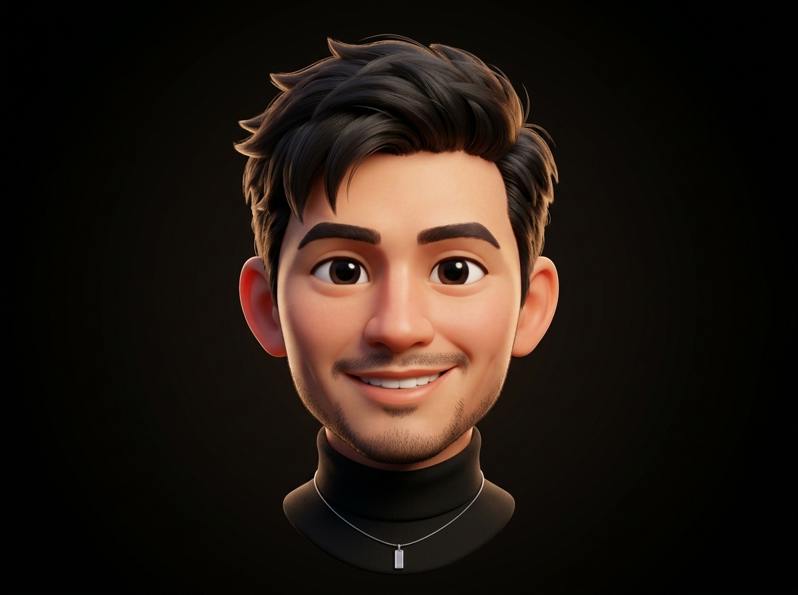

<table>
  <tr>
    <td width="110" align="center" valign="middle">
      
    </td>
    <td valign="middle">
      
       
      Crafting refined <strong>websites</strong>, <strong>interactive 3D UI</strong>, and <strong>web applications</strong> — while exploring <strong>AI Engineering</strong>.
    </td>
  </tr>
</table>

### Selected Work

| Project | Focus | Link |
| :--- | :--- | :--- |
| **Portfolio** | Personal web & selected work | [`portfolio-eza`](https://github.com/Ezsaaa/portfolio-eza) |
| **Web Service Landing Page** | Business & web service showcase | [`landing-page-jasa-web`](https://ezsaaa.github.io/landing-page-jasa-web/) |
| **3D Login Interface** | Interactive 3D login UI | [`Login-3d`](https://github.com/Ezsaaa/Login-3d) |

### Core Stack

`TypeScript` · `JavaScript` · `HTML / CSS` · `3D Web` · `Python & AI`

### Contact

* **Email:** `rezaardinata166@gmail.com`
